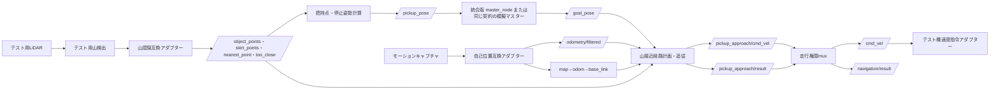

# 統合版互換契約とテスト機構成

更新日: 2026-10-21

## 目的

最終統合先は `NEDO_ROS_2026_integrated_ver-main/ros_ws` とする。別機体、モーションキャプチャ、別LiDAR、別のスクラップ山検出アルゴリズムを使う試験でも、走行制御から見えるROS 2境界を統合版と同じに保つ。

試験装置固有の名前や座標系を走行制御へ直接持ち込まない。差分は入力アダプター、出力アダプター、機体別パラメータに閉じ込める。これにより、試験後はアダプターとパラメータを統合機向けへ交換し、走行制御コアを変更せずに統合できる構成を目指す。

## 互換性に含める項目

トピック名とメッセージ型だけでは互換とは判定しない。次をすべて契約に含める。

- トピック名、サービス名、メッセージ型
- `header.frame_id` と `child_frame_id`
- TFの親子関係、取付変換、各TFを配信するノードが一つだけであること
- x、y、z軸の向き、yawの正方向、m・s・radなどの単位
- `header.stamp`の時計領域、更新周期、許容遅延
- 自己位置と速度の共分散の意味
- QoS、欠測、古いデータ、再起動、時刻逆行時の扱い
- 目標が車体中心基準であること、および到着まで固定されること
- 走行指令の発行権と、停止・到着通知の意味

## 統合版を基準とする正規I/O

### 走行制御の境界

|方向|名前|型|座標系・意味|試験機での生成方法|
|---|---|---|---|---|
|入力|`/odometry/filtered`|`nav_msgs/msg/Odometry`|融合済み自己位置。`header.frame_id=map`、`child_frame_id=base_link`。姿勢、車体速度、共分散を含む|モーションキャプチャ変換ノードが生成|
|入力|`/goal_pose`|`geometry_msgs/msg/PoseStamped`|`map`系の車体中心目標位置・姿勢。統合版の`master_node`が発行|統合シーケンス試験では`master_node`、単体試験では模擬ノードが発行|
|内部入力|`/pickup_approach/path`|`nav_msgs/msg/Path`|`map`系の計画経路。終点は`/goal_pose`と一致|山接近用経路計画器が生成|
|安全入力|`/scrap_pile_skirt_node/too_close`|`std_msgs/msg/Bool`|最新の山観測に基づく接近禁止|テスト山検出器の出力を変換、または互換ノードが生成|
|専用出力|`/pickup_approach/cmd_vel`|`geometry_msgs/msg/Twist`|`base_link`系の前後速度、左右速度、旋回速度|山接近制御が発行し、走行権限muxへ渡す|
|診断出力|`/pickup_approach/debug_cmd_vel`|`geometry_msgs/msg/Twist`|実指令無効時にも確認できる計算結果|山接近制御が発行|
|内部結果|`/pickup_approach/result`|`std_msgs/msg/String`|山接近制御の`planned`、`arrived`、`blocked`等|走行権限・結果調停器へ渡す|
|統合結果|`/navigation/result`|`std_msgs/msg/String`|統合版`master_node`が待つ`planned`、`arrived`、`blocked`|選択中の走行系の結果だけを調停器が中継|
|状態|`/pickup_approach/status`|`std_msgs/msg/String`|停止理由、入力鮮度、権限、目標・経路の保持状態|山接近制御が発行|

`pickup_approach_controller` の正規目標入力は `/goal_pose` に修正した。統合版では `pickup_planner_node -> /pickup_pose -> master_node -> /goal_pose -> 走行系` という流れになる。`/pickup_pose` を走行制御へ直結すると、`master_node`の状態管理を迂回するため、統合試験には使用しない。

`/pickup_approach/result`を常時 `/navigation/result`へ直接変更することもしない。巡回走行系も同じ統合結果を使うため、最上位の走行権限・結果調停器が、現在選択中の走行系の結果だけを `/navigation/result`へ中継する。

### スクラップ山認識・把持計画の境界

|名前|型|正規フレーム|意味|
|---|---|---|---|
|`/scrap_pile_skirt_node/object_points`|`sensor_msgs/msg/PointCloud2`|`map`|地面やランドマーク等を除いた山の物体点群|
|`/scrap_pile_skirt_node/skirt_points`|`sensor_msgs/msg/PointCloud2`|`map`|3D点群から抽出した地面と山の境界|
|`/scrap_pile_skirt_node/nearest_point`|`geometry_msgs/msg/PointStamped`|`map`|車体中心に対する可視山表面のXY最近傍点|
|`/scrap_pile_skirt_node/too_close`|`std_msgs/msg/Bool`|座標なし|車体外形と安全余裕を考慮した接近禁止|
|`/scrap_pile_skirt_node/enable`|`std_srvs/srv/SetBool`|座標なし|山検出の有効・無効切替|
|`/pickup_planner_node/next`|`std_srvs/srv/Trigger`|座標なし|最新スキャンに対する次の把持計画要求|
|`/pickup_planner_node/grasp_point`|`geometry_msgs/msg/PointStamped`|統合版の出力に従う|グラップルが把持する点|
|`/pickup_pose`|`geometry_msgs/msg/PoseStamped`|`map`|把持点から計算した車体中心の停止位置・姿勢|

テスト機で別のLiDARや検出アルゴリズムを使う場合、次のいずれかで接続する。

1. テスト検出器が上表の下流I/Oをそのまま発行する。
2. テスト検出器の固有出力を互換アダプターで上表のI/Oへ変換する。
3. 統合版の `pickup_planner_node` を使う場合は、少なくとも `object_points`、TF、機体・アーム寸法を統合版の契約へ合わせる。

試験用アルゴリズムから `/pickup_pose` を直接発行してもよいが、位置は車体中心、姿勢は `base_link` のyaw、座標系は `map`、到着通知まで同じ目標を保持する。

## 正規TFツリー

```text
map
└── odom
    └── base_link
        ├── base_footprint
        ├── <自己位置・障害物用LiDARフレーム>
        └── <山検出用LiDARフレーム>
```

統合版のデュアルEKF構成では、グローバルEKFが `map -> odom`、ローカルEKFが `odom -> base_link` を配信する。テスト機ではモーションキャプチャを `map` に合わせ、簡易構成として `map -> odom` を恒等変換、モーションキャプチャ変換ノードを `odom -> base_link` の唯一の配信元にできる。

守るべき条件は次のとおりである。

- `base_link` のXY原点は走行制御が扱う車体中心とする。
- `base_footprint` は平面走行用の地面投影フレームとし、`base_link`とのXY原点を一致させる。
- 同じ親子TFを複数ノードから配信しない。
- モーションキャプチャのワールド座標から `map` への較正変換を明示し、起動のたびに暗黙に変えない。
- LiDAR取付値はテスト機の実測値を使う。統合機と数値が異なってもよいが、親を `base_link`、子を実際の点群の `frame_id` と一致させる。
- ROS時刻、モーションキャプチャ時刻、LiDAR時刻を同じ時計領域へそろえる。受信時刻への単純な置換は診断可能な設定として扱う。

## 機体ごとに変更してよい項目

次はインターフェースではなく構成値なので、テスト機と統合機で分ける。

|分類|主な値|
|---|---|
|車体|前後左右の外形、車体中心、最大速度、最大加速度、最大旋回速度|
|梁・グラップル|取付位置、長さ、高さ、把持可能範囲、走行中の格納形状|
|LiDAR|取付TF、入力トピック、更新周期、視野、測距精度|
|自己位置|モーションキャプチャの測定分散、更新周期、遅延、欠測判定|
|山認識|クラスタ条件、地面分離条件、裾抽出条件、安全余裕|
|制御|速度・加速度・ジャーク・スナップ制限、停止許容差|

値は `test_platform` と `integrated_rover` の二つの設定プロファイルに分ける。ソースコード中の条件分岐で機体名を判定しない。

## テスト機の境界構成



今回の計測では、`natnet_ros2`のノード`/natnet_ros`が `/rover_1021/pose` を `geometry_msgs/msg/PoseStamped`、`frame_id=world`、RELIABLE/VOLATILE、約100 Hzで発行している。これを受ける `mocap_localization_adapter` を追加し、`/odometry/filtered`、`/robot_pose`、任意の正規TFへ変換する。Motiveの軸方向とOptiTrack剛体原点から車体中心までの取付値は、現場での軸移動試験と実測により較正する。

## この試験で確認できる範囲

別機体でも、ROS 2接続、状態遷移、目標保持、経路計画・追従の論理、到着通知、欠測停止、走行権限の排他制御は確認できる。一方、統合機固有の車体外形・梁干渉、タイヤ特性、最大加減速、自己位置誤差、LiDAR死角、山認識精度は別機体試験だけでは合格にできない。これらは統合機プロファイルと実機ログを使って再評価する。

## 試験の合格条件

1. `ros2 topic info -v`で正規トピックの型、送受信数、QoSを確認できる。
2. TFツリーにループ、重複配信、長時間の欠損がない。
3. 静止時の `/odometry/filtered` の平均、標準偏差、共分散、時刻単調性を記録できる。
4. 車体を既知方向へ動かし、`base_link`の+x/+yとyaw正方向が指令規約と一致する。
5. 既知座標の目標を送り、`/goal_pose`と計画経路の終点が一致する。
6. 山観測を停止または古くしたとき、走行指令がゼロになる。
7. 到着時だけ `arrived` が一度発行され、選択中の走行系の結果だけが `/navigation/result`へ届く。
8. 走行権限切替中、自己位置異常時、TF欠損時は最終 `/cmd_vel` がゼロになる。

## 次の実装順序

1. `world`の+x/+y/+zとyaw正方向を既知方向への移動で確認する。
2. OptiTrack剛体原点から車体中心`base_link`までの取付値を測定する。
3. `mocap_localization_adapter`の較正値を設定し、静止時の位置・速度・共分散を記録する。
4. テスト機の車体、梁、LiDAR取付値を `test_platform` 設定へ分離する。
5. テスト山検出器の出力を正規の山認識I/Oへ変換する。
6. 走行権限muxと結果調停を実装し、巡回側と山接近側が同時に最終指令・結果を発行しないようにする。
7. 静止、軸方向、目標到着、観測欠測、TF欠損、権限切替の順で試験する。

